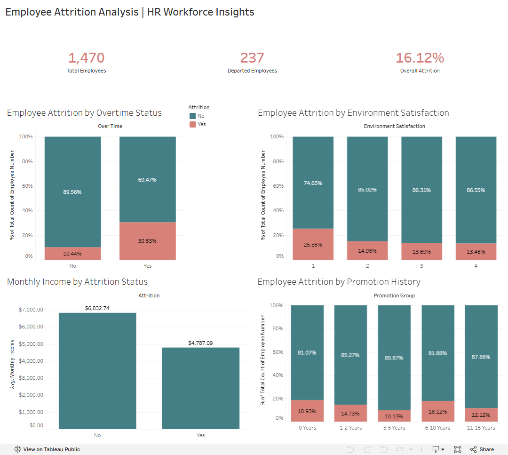

# Employee Attrition Analysis

## Business Task

Analyze employee data to identify patterns in employee attrition that may help HR leadership better understand workforce turnover and improve retention.

The analysis focuses on four questions:

1. How does attrition vary by time since last promotion?
2. Is employee salary associated with attrition?
3. How do attrition rates compare between employees who work overtime and those who don't?
4. Is environment satisfaction associated with employee attrition?

## Dataset

[IBM HR Analytics Employee Attrition & Performance](https://www.kaggle.com/datasets/pavansubhasht/ibm-hr-analytics-attrition-dataset)

The dataset contains 1,470 fictional employee records, including information about compensation, overtime, promotion history, and job satisfaction.

## Tools

- **Google BigQuery (SQL)** — Data quality assessment and analysis
- **Tableau Public** — Interactive data visualization

## Data Quality Assessment

Used SQL to check for duplicate or missing employee IDs, missing income values, invalid environment satisfaction scores, and inconsistencies between promotion history and company tenure.

No issues were identified in the fields and conditions checked.

## SQL Analysis

[View SQL Queries](SQLQueries.sql)

## Key Findings

- **Promotion History:** The 0-year group had the highest attrition percentage at 18.93%, followed by the 6–10-year group at 18.12%. Attrition did not consistently increase with time since last promotion.
- **Monthly Income:** Employees who stayed earned an average of $6,832.74 per month, compared to $4,787.09 for employees who left.
- **Overtime:** Employees who worked overtime had an observed attrition percentage approximately 2.9 times that of employees who didn't work overtime.
- **Environment Satisfaction:** Employees with the lowest environment satisfaction score had the highest attrition percentage at 25.35%.

These findings show associations within the dataset, not confirmed causes of employee departures.

## Tableau Dashboard

[View Interactive Dashboard on Tableau Public](https://public.tableau.com/app/profile/morgan.jellison/viz/EmployeeAttritionAnalysis_17954566499880/EmployeeAttritionDashboard)

